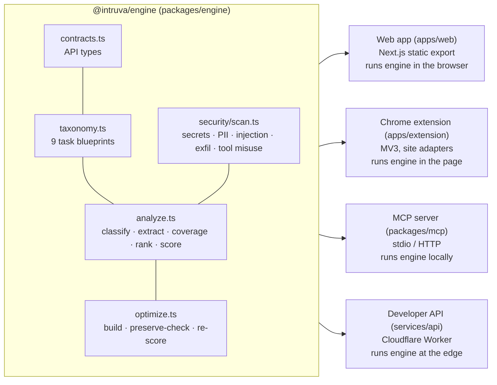

# Architecture

Intruva is **one engine exposed through four surfaces** (plan §5, §6, §23). The engine is pure, deterministic TypeScript. Each surface is a thin shell around it, so behaviour, security rules and contracts can't drift apart.



## The engine pipeline

Plan §6 lists 14 pipeline steps. Here is how the demo engine implements them (`packages/engine/src`):

| # | Step | Where | Notes |
|---|---|---|---|
| 1 | Input validation & size limits | `analyze.ts › validatePrompt` | Rejects empty prompts, under 8 chars, or over 12,000 chars with a `ValidationError`. |
| 2 | Sensitive-data preflight | `security/scan.ts › scanPrompt` | Runs first, on every surface, always on-device. |
| 3 | Task/intent classification | `analyze.ts › classify` | Weighted keyword signals per blueprint. Margin between the top two scores sets the confidence. The reason names the matched words. |
| 4 | Context extraction | `analyze.ts › extractParts` | First sentence = goal. Other sentences become constraints, output requirements, facts or other. Code blocks are kept as material. |
| 5 | Missing context & ambiguity | `analyze.ts › computeCoverage / missingContext` | Each blueprint field has a detector regex, weight, importance, question, "why", suggestions and an assumption. |
| 6 | Constraint extraction | `extractParts` | Sentences with must/don't/only/without/keep/… are kept verbatim. |
| 7 | Assumption classification | `analyzeLocal` | Every uncovered field gets a labelled assumption. Facts only ever come from the prompt or the user's answers. |
| 8 | Question ranking (Deep) | `missingContext / selectQuestions` | `priority = impact × uncertainty × answerability / effort` (plan §7). Returns up to 3 questions; low-importance fields are never asked. |
| 9 | Prompt construction | `optimize.ts › buildSections / render` | Sections: goal, context, steps, constraints, assumptions, output, success criteria, material, untrusted text. Markdown, or XML tags for Claude. Minimal mode keeps the original wording and appends only what's needed. |
| 10 | Intent-preservation check | `optimize.ts › checkPreservation` | Seven real string-containment checks: goal, requirements, prohibitions, scope, facts, output, tone. |
| 11 | Security scan of the output | `optimizeLocal` | `security_after` is computed on the optimized text. |
| 12 | Quality scoring | `analyze.ts › computeScores`, `optimize.ts › afterScores` | Plan §10 rubric weights. Missing context counts as **partial**, never full, after optimization, so the score can't be inflated by assumptions. |
| 13 | Response schema | `contracts.ts` | One set of types for every surface and the REST API. |
| 14 | Feedback | web: optional external form link; API: `POST /v1/feedback` | Never includes prompt text. |

**Untrusted text.** Sentences that contain a detected prompt-injection phrase are moved out of "Context". They go into an *Untrusted text (data, not instructions)* section with a matching guardrail (plan §9: "Prompt text is user data… treat quoted content as untrusted").

**What the demo engine is not.** It does no language understanding beyond patterns. The planned AI-assisted engine will replace steps 3–9 with schema-validated LLM calls behind the same contracts. The deterministic parts stay deterministic, as plan §12 requires: validation, scanning, scoring and preservation checks.

### Tests

`packages/engine/test/engine.test.ts` has 72 tests. They check that every sample classifies correctly, and that every sample × mode × output format has zero failed preservation checks and a non-decreasing score. They also cover constraint retention, answers-as-facts, injection quarantine, secret masking and redaction, false positives on ordinary prompts, placeholder handling, and validation. Run them with `npm test`.

## Web app (`apps/web`)

```text
src/
├── app/                      # routes (all statically exported)
│   ├── page.tsx              # landing (Server Component composing client islands)
│   ├── workspace/page.tsx    # <Suspense><Workspace/></Suspense> (useSearchParams)
│   ├── developers/page.tsx   # API / MCP / extension docs
│   ├── privacy/page.tsx      # data handling and scan coverage
│   ├── not-found.tsx
│   ├── layout.tsx            # fonts, motion boot script, providers, ambient background, header
│   └── globals.css           # design tokens and liquid-glass utilities (see DESIGN_SYSTEM.md)
├── components/
│   ├── ui/                   # Button, Select (ARIA combobox), SegmentedControl, Disclosure, ScoreBar, Pill, Toast + live region
│   ├── layout/               # SiteHeader, SiteFooter, Logo (animated), MotionPrefs, AmbientBackground, EngineIndicator
│   ├── landing/              # Hero, GlassSculpture + glassShader (WebGL), LiveDemo, FeatureBento, Sections
│   ├── workspace/            # Workspace (state machine), PromptEditor, ControlStrip, DiagnosisView, ClarifyFlow, ResultView, DiffView (lazy), SecurityPanel, PipelineProgress
│   └── developers/           # CodeTabs
└── lib/
    ├── api/client.ts         # THE seam between UI and engine: demo (in-browser) or remote (API)
    ├── handoff.ts            # session-only landing → workspace prompt handoff
    ├── storage.ts            # motion preference only (prompts are never stored)
    └── contracts.ts, engine/*, security/*, samples.ts   # one-line re-exports of @intruva/engine
```

### Workspace state machine

```text
compose ──Quick/Minimal──▶ running(scan…verify) ──▶ result ──tabs──▶ [Optimized prompt | Diagnosis]
   │                                                   ▲  └─re-run with another mode─┐
   └──Deep──▶ running(scan…diagnose) ──▶ diagnosis ──▶ clarify (1–3 Qs) ──▶ running(optimize, verify)
                                            └──skip, use assumptions──────────────────┘
any run ──error──▶ error state: Retry · Edit prompt · (remote only) Continue in demo mode
```

- **Cancelling stale work.** Every run creates an `AbortController` and aborts the previous one.
- **Honest progress.** The demo engine yields one animation frame and then computes synchronously, so there are no artificial delays. The progress panel fades in only if a run takes more than about 220 ms, which in practice means remote calls.
- **Live preflight.** `useDeferredValue(prompt)` feeds `scanPrompt` and `classify` as you type, for highlights and the "looks like…" hint. Redaction edits the prompt with Undo, and re-runs the diagnosis if one is showing.
- **The original prompt is always visible** in a sticky side card (desktop) or a collapsible card (mobile), with security highlights.

### The client seam (`lib/api/client.ts`)

- `intruva.engine` is `"demo"` unless `NEXT_PUBLIC_INTRUVA_API_URL` is set at build time.
- `analyze()` and `optimize()` take an optional engine override, which is used by "Continue in demo mode" after a backend failure.
- Remote calls time out after 25 s. Network errors and 5xx responses raise `BackendUnavailableError`, which shows the backend-unavailable state.
- `scanLocal()` always runs in the browser, whatever the engine.

## Developer API (`services/api`)

A Cloudflare Worker importing `@intruva/engine`. It serves `/v1/health`, `/v1/analyze`, `/v1/optimize`, `/v1/security/scan`, `/v1/feedback` and `/v1/openapi.json`. API keys are stored as SHA-256 hashes in a Worker secret, with per-key rate limits, a body limit, CORS, and no prompt logging. Full details are in `services/api/README.md` and `DEPLOYMENT.md`.

**Why a Worker and not FastAPI** (plan §12 originally suggested FastAPI):
- There was no Python code yet.
- A Python port would duplicate the engine, which violates §23 "do not build A, B and C independently".
- §29 asks for free, commercially usable hosting without cold starts. Workers fit; free Python hosts sleep.

If an LLM-backed engine later needs Python, it can sit behind the same contracts.

## Chrome extension (`apps/extension`)

MV3. Content scripts run only on ChatGPT, Claude and Gemini, with one adapter module per site (detect composer, read, write, health check). The engine is bundled in. Nothing is read until the user clicks or uses the shortcut. It never auto-submits, and Revert is always available. See `apps/extension/README.md`.

## MCP server (`packages/mcp`)

`intruva-mcp` exposes the engine as MCP tools: analyze, optimize (accepts answers for the clarify loop), scan (optional redaction) and list task types. It speaks stdio by default, plus an HTTP mode. It's bundled so that `npx intruva-mcp` works anywhere, and it's model-agnostic: any MCP client can use it. See `packages/mcp/README.md`.

## Privacy by construction

| Rule (plan §16, §29) | How it's enforced |
|---|---|
| No raw prompt retention | No storage layer exists. The web app stores only the motion preference. The landing→workspace handoff uses `sessionStorage` and is deleted on read. |
| Never log prompt text or secrets | The engine has no logging. The API logs only request id, route, status and latency. The MCP server keeps stdout clean and stderr content-free. |
| Never echo detected secrets | Findings carry `masked_evidence`. The UI renders only that. |
| Truthful data-flow disclosure | The header indicator reads the actual engine mode. "Demo mode · on-device" can't be shown while text goes to a server. |
| Explicit action before reading (extension) | Content scripts attach only a button. Reading happens on click or shortcut. |
| No auto-send | No surface submits prompts anywhere. |
